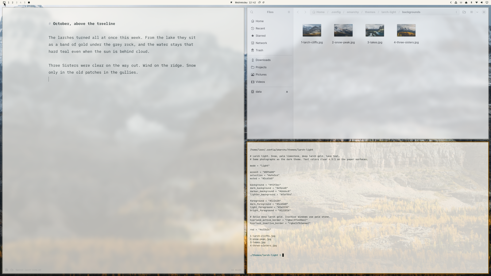
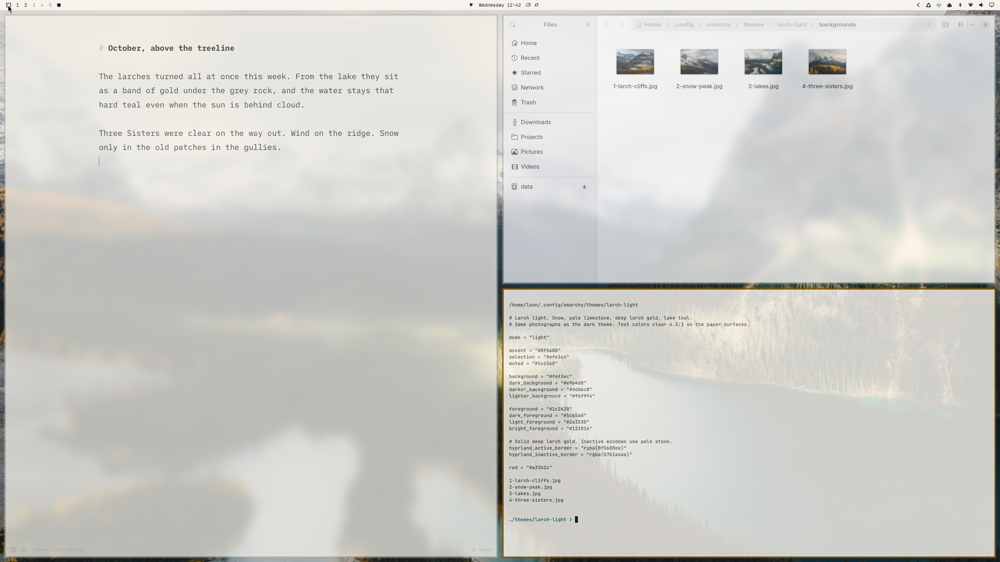
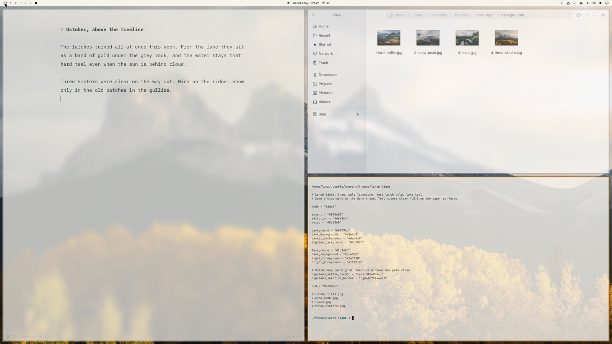

# Larch light

Light Omarchy theme from the same Rockies photographs as [larch](https://github.com/nchudleigh/omarchy-larch-theme). Snow, pale limestone, deep larch gold, lake teal.

```bash
omarchy theme install https://github.com/nchudleigh/omarchy-larch-light-theme
```

The theme shows up as **larch-light**. Cycle the four photographs with `omarchy theme bg next`.

The window border is one color, deep larch gold. Text colors clear 4.5:1 on the paper surfaces.

Shot on loon.






